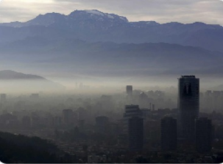
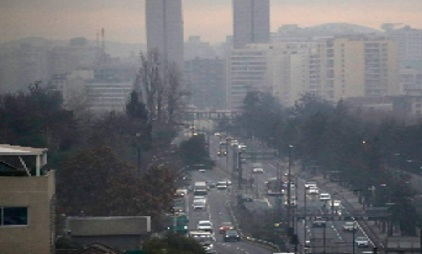
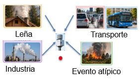
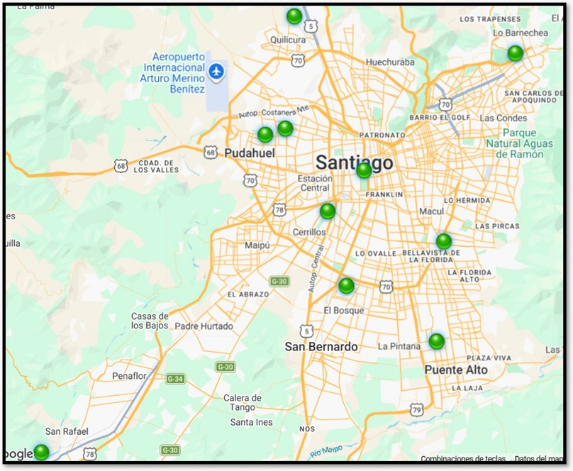
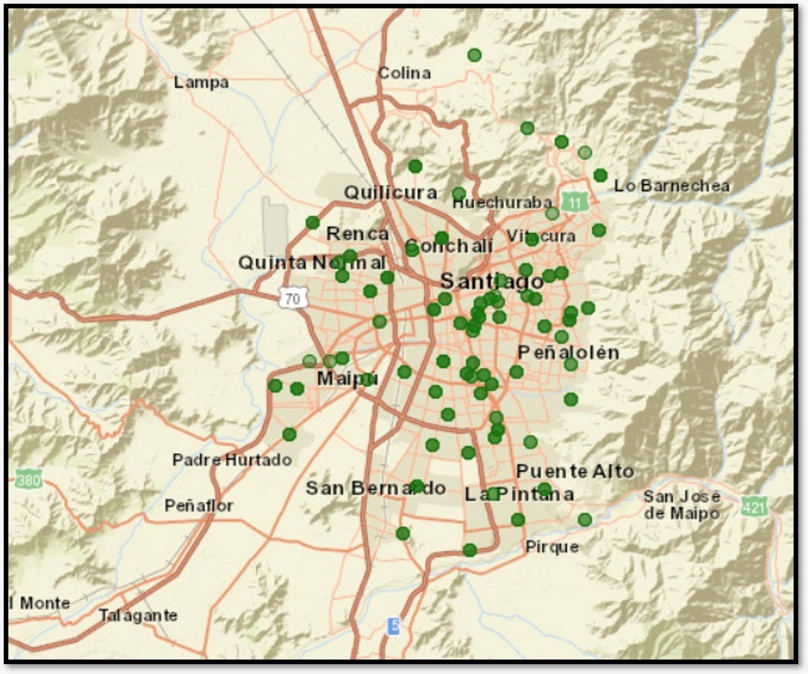
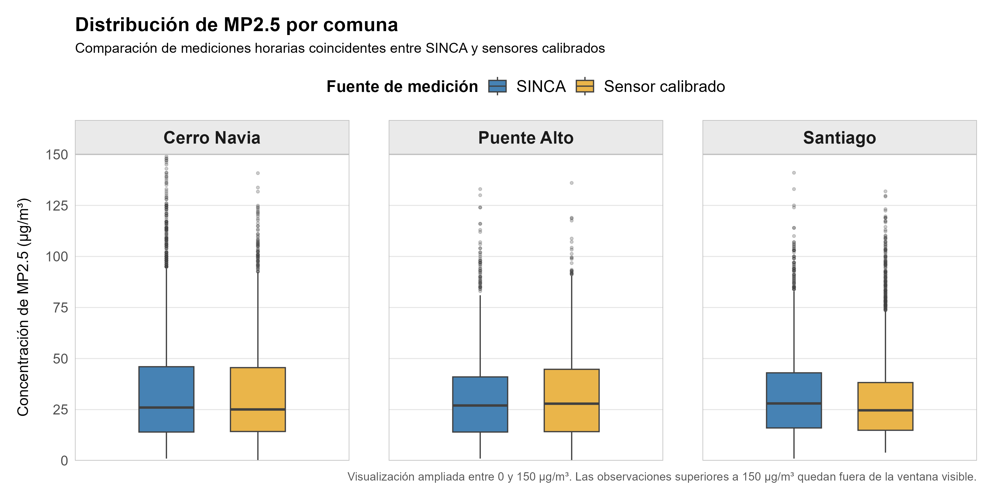
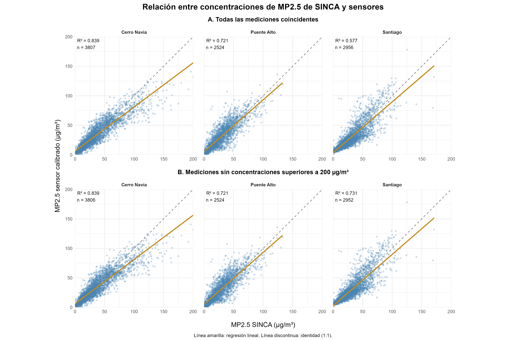
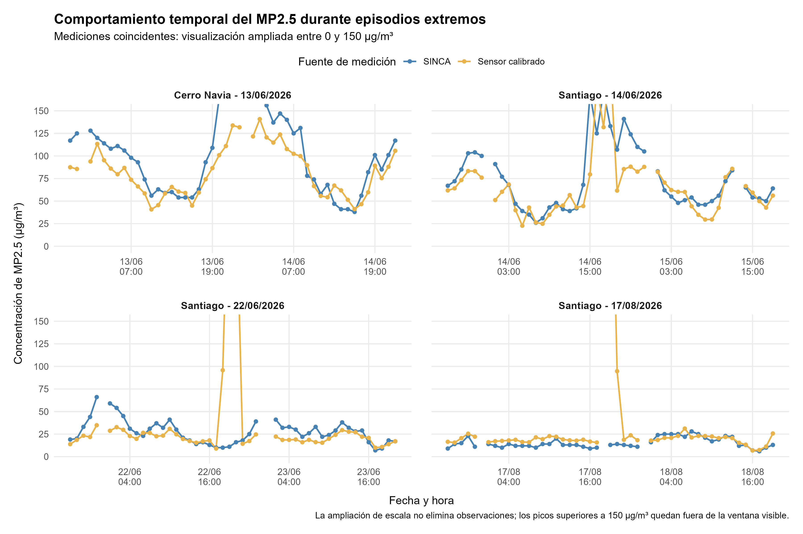

<style>
body {font-family: "Segoe UI", Arial, sans-serif; color: #171717; font-size: 16px; line-height: 1.7;}
#quarto-content {max-width: 1120px; margin: 0 auto;}
main.content {max-width: 1000px; margin: auto;}
#title-block-header {text-align: center; border: 1px solid #d4dce5; border-radius: 14px; padding: 26px 22px; margin: 12px auto 24px; background: #fbfcfe;}
#title-block-header .title {font-size: 2.2rem; font-weight: 750; color: #171717;}
#title-block-header .subtitle {font-size: 1.25rem; color: #171717; font-weight: 550;}
#title-block-header .quarto-title-meta {justify-content: center;}
h2 {color: #171717; border-bottom: 2px solid #d8e7f3; padding-bottom: 8px; margin-top: 38px;}
h3 {color: #171717; margin-top: 24px;}
.indice-botones {display: flex; flex-wrap: wrap; justify-content: center; gap: 10px; margin: 25px auto 35px;}
.indice-botones a {display: inline-block; padding: 10px 16px; background: #eaf2fa; color: #174c75; border: 1px solid #bcd1e4; border-radius: 9px; text-decoration: none; font-weight: 650;}
.indice-botones a:hover {background: #d8e7f3; color: #123c5d;}
.portada-imagen {text-align: center; margin: 16px auto 24px;}
.portada-imagen img {width: 70%; max-width: 650px; border: 1px solid #d5dfe9; border-radius: 12px;}
/* Estilo uniforme para las tablas del informe */
.table-responsive, .table-responsive-sm {overflow-x: auto;}
table {width: 100%; border-collapse: collapse; border: 1px solid #d9e3ed; font-size: 0.94rem; margin: 18px auto 26px;}
table thead th {background: #eaf2fa !important; color: #171717 !important; font-weight: 700; border-bottom: 2px solid #bcd1e4 !important; padding: 11px 12px !important;}
table tbody td {padding: 10px 12px !important; border-bottom: 1px solid #e4e9ef !important; vertical-align: middle; color: #171717;}
table tbody tr:nth-child(even) {background: #f8fafc;}
table tbody tr:hover {background: #f0f6fc;}
figure {text-align: center; margin: 22px auto;}
figure img {border-radius: 8px; max-width: 100%;}
figcaption, .figure-caption {font-size: 0.9rem; color: #4b5563; text-align: center;}
.arbol-repositorio {background: #f7f9fc; border: 1px solid #d9e3ed; border-radius: 10px; padding: 16px; overflow-x: auto; font-size: 0.82rem; line-height: 1.55;}
/* Evitar palabras moradas o destacadas en el cuerpo del texto */
main.content a, main.content a:visited {color: #171717; text-decoration-color: #9aa7b5;}
main.content p code, main.content li code, main.content td code {color: #171717 !important; background: transparent !important; font-weight: 400; padding: 0;}
main.content p strong, main.content li strong {font-weight: 400;}
</style>

<div class="portada-imagen">

</div>

Este informe presenta un análisis exploratorio de las concentraciones horarias de material particulado fino (MP2.5) en Santiago de Chile, mediante la comparación de mediciones de estaciones SINCA y sensores de bajo costo previamente calibrados en tres comunas.

<div class="indice-botones">
<a href="#introduccion">Introducción</a>
<a href="#video">Video</a>
<a href="#objetivos">Objetivos</a>
<a href="#area-estudio">Área de estudio</a>
<a href="#diccionario">Diccionario de datos</a>
<a href="#repositorio">Organización del repositorio</a>
<a href="#metodologia">Metodología</a>
<a href="#resultados">Resultados</a>
<a href="#conclusiones">Conclusiones</a>
<a href="#reproducibilidad">Reproducibilidad</a>
<a href="#referencias">Referencias</a>
</div>

## Introducción {#introduccion}

El material particulado fino (MP2.5) constituye un problema relevante para la calidad del aire en Santiago de Chile. Su comportamiento presenta variaciones espaciales y temporales que pueden explorarse mediante el análisis de registros horarios de monitoreo atmosférico.

Se seleccionaron Cerro Navia, Santiago y Puente Alto por su ubicación en distintos sectores de la ciudad: poniente, centro y suroriente, respectivamente. Esta distribución permite explorar posibles diferencias espaciales en las concentraciones de MP2.5. Además, en las tres comunas se dispone de mediciones de estaciones SINCA y sensores de bajo costo calibrados, lo que permite comparar registros horarios coincidentes entre ambas fuentes.

El trabajo caracteriza la distribución de concentraciones, examina la relación lineal entre ambas fuentes y estudia la influencia de observaciones extremas. La calibración instrumental de los sensores no forma parte del estudio.

| Contexto urbano de Santiago | Fuentes y monitoreo de MP2.5 |
|:---:|:---:|
| {width=95%} | {width=95%} |

**[Ver el informe HTML publicado](https://moliveraf.github.io/proyecto-final-mp25/)**

## Video de apoyo {#video}

El siguiente recurso audiovisual complementa la presentación del contexto del estudio.



## Objetivos {#objetivos}

### Objetivo general

Analizar exploratoriamente las concentraciones horarias de MP2.5 registradas por estaciones SINCA y sensores de bajo costo calibrados en Cerro Navia, Santiago y Puente Alto.

### Objetivos específicos

1. Explorar, documentar, validar y depurar los registros de ambas fuentes.
2. Comparar las distribuciones de las concentraciones de MP2.5 entre comunas y fuentes de medición.
3. Evaluar la asociación lineal entre las mediciones horarias coincidentes.
4. Examinar la sensibilidad de los modelos a valores extremos e identificar episodios de concentraciones elevadas.

## Área de estudio y fuentes de información {#area-estudio}

Las estaciones SINCA y los sensores de bajo costo calibrados se distribuyen en los siguientes sectores de Santiago:

| Comuna | Sector | Estación SINCA | Sensor calibrado |
|:---|:---|:---|:---|
| Cerro Navia | Poniente | Cerro Navia | CH4 |
| Santiago | Centro | Parque O'Higgins | CH56 |
| Puente Alto | Suroriente | Puente Alto | CH2 |

### Períodos de disponibilidad

| Fuente | Período disponible |
|:---|:---|
| SINCA (tres estaciones) | 01/03/2026–30/09/2026 |
| Sensor CH4 | 19/03/2026–12/09/2026 |
| Sensor CH56 | 16/04/2026–27/08/2026 |
| Sensor CH2 | 05/05/2026–31/08/2026 |

| Estaciones SINCA | Sensores de bajo costo calibrados |
|:---:|:---:|
| {width=95%} | {width=95%} |

Los datos proceden del [Sistema de Información Nacional de Calidad del Aire (SINCA)](https://sinca.mma.gob.cl/) y de registros calibrados facilitados para el proyecto ([Aire Ciudadano](https://sensor.aireciudadano.com/d/xTdfdbchs/sensores-chs?orgId=1)). Se conservaron los datos originales y se compararon únicamente las observaciones con fecha y hora coincidentes.

## Diccionario de datos {#diccionario}

Se elaboró un único diccionario manual mediante la función tribble(), para documentar las variables comunes a las estaciones SINCA y los sensores calibrados.

| Variable | Descripción | Tipo | Unidad | Valores esperados y faltantes |
|:---|:---|:---|:---|:---|
| `fuente` | Origen de la medición | Categórica | — | SINCA o sensor de bajo costo; sin NA |
| `comuna` | Sector de monitoreo | Categórica | — | Santiago, Cerro Navia o Puente Alto; sin NA |
| `mp25` | Concentración horaria de MP2.5 | Numérica | µg/m³ | No negativa; intervalo 2–200 para revisión exploratoria; NA identificados en validación y excluidos en depuración |
| `fecha_hora` | Fecha y hora de medición | Fecha-hora | — | Períodos de 2026 estudiados; sin NA en datos depurados |

Para SINCA, mp25 se obtiene mediante coalesce(), dando prioridad a registros validados, luego preliminares y finalmente no validados. Las concentraciones inferiores a 2 o superiores a 200 µg/m³ se revisan, pero no se eliminan automáticamente. Este intervalo es un criterio exploratorio de revisión, no un límite normativo.

## Organización del repositorio {#repositorio}

El repositorio se organiza en carpetas numeradas y nombres en minúsculas para facilitar la trazabilidad de los datos, los scripts y los resultados. Se muestra a continuación su estructura completa, siguiendo la documentación del README.

```{=html}
<div class="arbol-repositorio"><pre>
proyecto-final-mp25/
|
|-- 01_datos/
|   |-- 01_datos_crudos/
|   |   |-- 01_sinca/
|   |   |   |-- 01_sinca_cerro_navia_mp25_2026.csv
|   |   |   |-- 02_sinca_parque_ohiggins_mp25_2026.csv
|   |   |   |-- 03_sinca_puente_alto_mp25_2026.csv
|   |   |-- 02_sensores_bajo_costo/
|   |   |   |-- 01_sensor_cerro_navia_ch4_mp25_2026.csv
|   |   |   |-- 02_sensor_parque_ohiggins_ch56_mp25_2026.csv
|   |   |   |-- 03_sensor_puente_alto_ch2_mp25_2026.csv
|   |-- 02_datos_procesados/
|   |   |-- 01_sinca/
|   |   |   |-- 01_sinca_cerro_navia_mp25_2026.csv
|   |   |   |-- 02_sinca_parque_ohiggins_mp25_2026.csv
|   |   |   |-- 03_sinca_puente_alto_mp25_2026.csv
|   |   |-- 02_sensores_bajo_costo/
|   |   |   |-- 01_sensor_cerro_navia_ch4_mp25_2026.csv
|   |   |   |-- 02_sensor_parque_ohiggins_ch56_mp25_2026.csv
|   |   |   |-- 03_sensor_puente_alto_ch2_mp25_2026.csv
|   |   |-- 03_comparacion_sinca_sensores/
|   |   |   |-- 01_comparacion_cerro_navia.csv
|   |   |   |-- 02_comparacion_parque_ohiggins.csv
|   |   |   |-- 03_comparacion_puente_alto.csv
|   |   |   |-- 04_mediciones_horarias_coincidentes_sinca_sensores_tres_comunas.csv
|
|-- 02_scripts/
|   |-- 01_cargar_librerias.r
|   |-- 02_cargar_datos.r
|   |-- 03_explorar_datos.r
|   |-- 04_validar_datos.r
|   |-- 05_depurar_datos.r
|   |-- 06_integrar_mediciones_sinca_sensores.r
|   |-- 07_boxplots_sinca_sensores.r
|   |-- 08_regresion_lineal_r2_sinca_sensores.r
|   |-- 09_analizar_episodios_extremos.r
|
|-- 03_figuras/
|   |-- 01_comparacion_sinca_sensores/
|   |   |-- 01_boxplots/
|   |   |   |-- 01_boxplot_sinca_sensores_por_comuna.png
|   |   |   |-- 02_boxplot_sinca_sensores_por_comuna_ampliado.png
|   |   |-- 02_modelos_lineales/
|   |   |   |-- 01_regresion_lineal_r2_sinca_sensores_por_comuna.png
|   |   |-- 03_analisis_sensibilidad/
|   |   |   |-- 02_comparacion_regresiones_r2_sinca_sensores.png
|   |   |-- 04_episodios_extremos/
|   |   |   |-- 01_series_temporales_episodios_extremos.png
|   |   |   |-- 02_series_temporales_episodios_extremos_ampliado.png
|
|-- 04_tablas/
|   |-- 01_exploracion/
|   |   |-- 01_estadisticas_iniciales_sinca_sensores.csv
|   |-- 02_validacion/
|   |   |-- 01_diccionario_datos_sinca_sensores.csv
|   |   |-- 02_revision_duplicados_sinca_sensores.csv
|   |   |-- 03_resumen_alertas_sinca_sensores.csv
|   |   |-- 04_concentraciones_superiores_200_sinca_sensores.csv
|   |   |-- 05_registros_con_alertas_sinca_sensores.csv
|   |-- 03_depuracion/
|   |   |-- 01_resumen_datos_procesados_sinca_sensores.csv
|   |-- 04_integracion/
|   |   |-- 01_mediciones_coincidentes_sinca_sensores.csv
|   |-- 05_boxplots/
|   |   |-- 01_estadisticas_descriptivas_sinca_sensores_por_comuna.csv
|   |-- 06_regresion_lineal/
|   |   |-- 01_modelos_lineales_r2_sinca_sensores.csv
|   |   |-- 02_pares_extremos_sinca_sensores.csv
|   |   |-- 03_sensibilidad_r2_sinca_sensores.csv
|
|-- 05_imagenes/
|   |-- 01_santiago1.jpg
|   |-- 02_santiago2.jpg
|   |-- 03_fsensor.jpg
|   |-- 04_sinca.jpg
|   |-- 05_sensores.jpg
|
|-- 06_informe/
|   |-- informe_final_mp25_santiago.qmd
|
|-- renv/
|-- renv.lock
|-- .gitignore
|-- .Rprofile
|-- readme.md
|-- readme.html
|-- proyecto-final-mp25.Rproj
</pre></div>
```

## Metodología {#metodologia}

El procesamiento se realizó en R, principalmente con tidyverse y ggplot2. El análisis siguió las siguientes etapas:

| Etapa | Procedimiento |
|:---|:---|
| 1. Importación y exploración | Cargar seis archivos originales y revisar estructura, períodos y valores faltantes |
| 2. Validación | Homogeneizar variables; documentar datos; identificar duplicados, NA y alertas |
| 3. Depuración | Excluir concentraciones faltantes o negativas y registros sin fecha-hora válida |
| 4. Integración | Emparejar mediciones horarias coincidentes por comuna |
| 5. Distribución | Calcular estadísticas descriptivas y visualizar diagramas de caja |
| 6. Relación lineal | Ajustar regresiones por comuna y examinar R² |
| 7. Sensibilidad | Comparar modelos con todos los pares y sin pares con alguna concentración superior a 200 µg/m³ |
| 8. Episodios extremos | Examinar ventanas de 24 horas antes y después de los episodios |

Los modelos lineales permiten explorar la asociación entre las concentraciones medidas por SINCA y los sensores calibrados. R² expresa la proporción de variabilidad explicada por el modelo lineal; no demuestra por sí solo concordancia instrumental.

## Resultados {#resultados}

### Mediciones horarias coincidentes

Se integraron 9.287 pares horarios para comparar las fuentes en las tres comunas.

| Comuna | Pares coincidentes |
|:---|---:|
| Cerro Navia | 3.807 |
| Puente Alto | 2.524 |
| Santiago | 2.956 |
| Total | 9.287 |

### Distribución de las concentraciones de MP2.5

| Comuna | Promedio SINCA (µg/m³) | Promedio sensor (µg/m³) |
|:---|---:|---:|
| Cerro Navia | 34,1 | 31,7 |
| Puente Alto | 30,0 | 31,6 |
| Santiago | 31,8 | 30,8 |

{#fig-boxplots fig-align="center" width="95%"}

Cerro Navia presenta el mayor promedio SINCA de las tres comunas en los períodos coincidentes. Como los períodos de disponibilidad no son idénticos, estas diferencias deben interpretarse considerando la cobertura temporal.

### Regresión lineal y análisis de sensibilidad

| Comuna | R² con todos los pares | R² sin extremos | Pares excluidos |
|:---|---:|---:|---:|
| Cerro Navia | 0,839 | 0,839 | 1 |
| Puente Alto | 0,721 | 0,721 | 0 |
| Santiago | 0,577 | 0,731 | 4 |

{#fig-sensibilidad fig-align="center" width="95%"}

En Santiago, retirar cuatro pares extremos aumenta R² de 0,577 a 0,731. La exclusión se utiliza exclusivamente para el análisis de sensibilidad y no modifica la base general de mediciones coincidentes.

### Episodios extremos

Se identificaron cinco pares extremos, agrupados en cuatro episodios:

| Comuna | Fecha | Pares extremos | Fuente que supera 200 µg/m³ |
|:---|:---|---:|:---|
| Cerro Navia | 13/06/2026 | 1 | SINCA |
| Santiago | 14/06/2026 | 1 | CH56 |
| Santiago | 22/06/2026 | 2 | CH56 |
| Santiago | 17/08/2026 | 1 | CH56 |

{#fig-extremos fig-align="center" width="95%"}

Los episodios del 22 de junio y del 17 de agosto en Santiago muestran picos abruptos en CH56 sin incrementos equivalentes en Parque O'Higgins. Los registros disponibles no permiten identificar concluyentemente su origen.

## Conclusiones {#conclusiones}

Las mediciones de SINCA y sensores calibrados muestran asociaciones lineales positivas, con diferencias entre comunas. La comparación de los períodos coincidentes permite explorar variaciones espaciales en las concentraciones de MP2.5, mientras que los diagramas de caja y las regresiones describen diferencias entre fuentes.

Un número reducido de pares extremos modifica apreciablemente el ajuste en Santiago. Estos valores podrían relacionarse con un evento atípico, como un incendio, aunque su origen no ha sido determinado. Por ello, conviene examinar su contexto temporal antes de decidir si excluirlos de un análisis.

## Reproducibilidad {#reproducibilidad}

El repositorio conserva los datos originales, utiliza rutas relativas y registra el entorno de paquetes en renv.lock. Para restaurar y comprobar ese entorno desde la raíz del proyecto:

```r
renv::restore()
renv::status()
```

## Referencias {#referencias}

- [Sistema de Información Nacional de Calidad del Aire (SINCA)](https://sinca.mma.gob.cl/). Ministerio del Medio Ambiente de Chile.
- [Aire Ciudadano: sensores CHS](https://sensor.aireciudadano.com/d/xTdfdbchs/sensores-chs?orgId=1).
- Jorquera, H., & Barraza, F. (2012). Source apportionment of ambient PM2.5 in Santiago, Chile: 1999 and 2004 results. *Science of the Total Environment, 435–436*, 418–429. https://doi.org/10.1016/j.scitotenv.2012.07.049
- Romero, H., et al. (2010). Climas urbanos y contaminación atmosférica en Santiago de Chile. *EURE, 36*(109). https://www.scielo.cl/scielo.php?pid=S0250-71612010000300002&script=sci_arttext
- Wilke, C. O. (2019). *Fundamentals of Data Visualization*. O'Reilly Media. https://clauswilke.com/dataviz/
