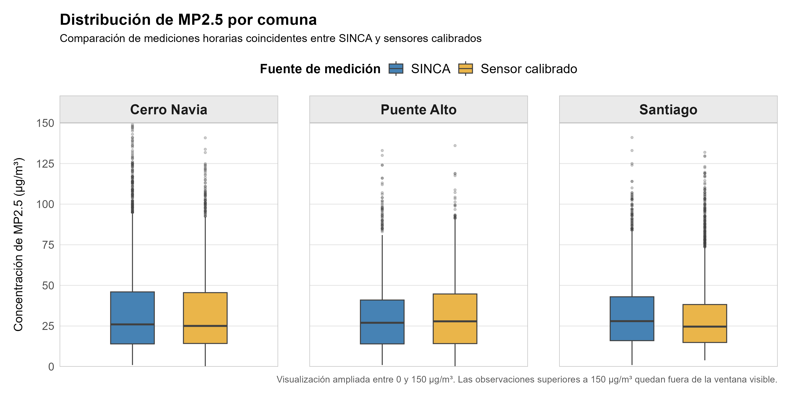

# Análisis exploratorio del MP2.5 en Santiago de Chile

**Autora:** María Cristina Olivera Ferrer  
**Institución:** Pontificia Universidad Católica de Chile  
**Programa:** Doctorado en Ciencias de la Ingeniería  
**Año:** 2026

---

## 1. Introducción y descripción del proyecto

El material particulado fino (MP2.5), constituido por partículas con diámetro aerodinámico inferior o igual a 2,5 µm, representa uno de los principales problemas de contaminación atmosférica en Santiago de Chile, debido a sus efectos adversos sobre la salud humana.

Entre sus principales fuentes de emisión se encuentran el transporte vehicular, las actividades industriales, la combustión residencial de leña y otros procesos de combustión.

Las características topográficas de la cuenca de Santiago, rodeada por sistemas montañosos, junto con determinadas condiciones meteorológicas, pueden favorecer la acumulación de contaminantes atmosféricos, especialmente durante los meses de otoño e invierno.

<p align="center">
  
</p>

<p align="center">
  <em>Figura 1. Contaminación atmosférica en Santiago de Chile.</em>
</p>

El Sistema de Información Nacional de Calidad del Aire (SINCA) proporciona registros oficiales de las concentraciones atmosféricas de MP2.5. Sin embargo, la incorporación de sensores de bajo costo previamente calibrados ofrece la posibilidad de complementar esta información y ampliar la cobertura espacial de las mediciones.

En este contexto, el presente proyecto analiza las concentraciones de MP2.5 en tres comunas de Santiago de Chile: Cerro Navia, Santiago y Puente Alto, utilizando registros horarios de estaciones SINCA y sensores de bajo costo calibrados.

El estudio se desarrolla mediante el lenguaje de programación R, aplicando procedimientos de exploración, validación, depuración, integración, análisis estadístico y visualización de datos ambientales.

Los resultados se integrarán en un informe elaborado mediante **Quarto**, orientado a la comunicación científica mediante una estrategia de narrativa de datos (storytelling).

## 2. Preguntas exploratorias y objetivos

### 2.1. Pregunta principal

¿Cómo varían las concentraciones de MP2.5 entre diferentes sectores de Santiago de Chile y qué semejanzas o diferencias se observan entre las mediciones de las estaciones SINCA y los sensores de bajo costo calibrados ubicados en sus proximidades?

### 2.2. Preguntas exploratorias

- ¿Qué disponibilidad y calidad presentan los registros horarios de ambas fuentes de medición?
- ¿Qué diferencias se observan en la distribución de las concentraciones de MP2.5 entre las comunas seleccionadas?
- ¿Qué relación lineal existe entre las concentraciones registradas por SINCA y los sensores calibrados?
- ¿Cómo influyen las concentraciones extremas sobre el coeficiente de determinación (R²)?
- ¿Cómo se comportan las concentraciones de MP2.5 antes, durante y después de los episodios extremos identificados?

### 2.3. Objetivo general

Analizar la variabilidad espacial y temporal de las concentraciones de MP2.5 en tres sectores de Santiago de Chile, mediante datos de estaciones SINCA y sensores de bajo costo calibrados.

### 2.4. Objetivos específicos

1. Importar, organizar y explorar los registros de MP2.5 de las estaciones SINCA y los sensores de bajo costo.
2. Evaluar la disponibilidad y calidad de los datos mediante procedimientos de validación y depuración.
3. Caracterizar la distribución y el comportamiento temporal de las concentraciones de MP2.5 en los sectores estudiados.
4. Comparar exploratoriamente las concentraciones registradas por SINCA y los sensores calibrados durante períodos coincidentes.
5. Evaluar la influencia de las concentraciones extremas sobre la relación lineal entre ambas fuentes de medición.
6. Elaborar visualizaciones, tablas y un informe que facilite la interpretación y reproducción de los resultados.

## 3. Área de estudio

### 3.1. Selección de las comunas

El estudio comprende tres comunas del área metropolitana de Santiago de Chile, ubicadas en diferentes sectores geográficos de la cuenca.

| Comuna | Sector geográfico | Características generales |
|---|---|---|
| Cerro Navia | Poniente | Ubicación en las zonas bajas de la cuenca de Santiago. |
| Santiago | Centro | Entorno urbano consolidado, con actividades residenciales, comerciales y vehiculares. |
| Puente Alto | Suroriente | Mayor proximidad a la cordillera de los Andes y al sector precordillerano. |

La selección de estas comunas responde a dos criterios:

- **Criterio geográfico:** interés por explorar las concentraciones de MP2.5 en sectores con diferentes características geográficas, topográficas y urbanas.
- **Criterio metodológico:** disponibilidad de registros horarios provenientes de estaciones SINCA y sensores de bajo costo calibrados ubicados en sus proximidades.

Esta distribución espacial permite explorar posibles diferencias en las concentraciones de MP2.5 entre distintos sectores de la cuenca de Santiago.

Las características geográficas constituyen elementos de contextualización del estudio. No se evalúa directamente la influencia de las variables meteorológicas o topográficas sobre las concentraciones observadas.

### 3.2. Estaciones y sensores seleccionados

| Comuna | Estación SINCA | Sensor calibrado |
|---|---|---|
| Cerro Navia | Cerro Navia | CH4 |
| Santiago | Parque O'Higgins | CH56 |
| Puente Alto | Puente Alto | CH2 |

## 4. Fuentes de datos

### 4.1. Redes de monitoreo

<table>
  <tr>
    <td align="center"><b>Estaciones oficiales SINCA</b></td>
    <td align="center"><b>Sensores de bajo costo</b></td>
  </tr>
  <tr>
    <td></td>
    <td></td>
  </tr>
</table>

<p align="center">
  <em>Figura 2. Distribución espacial de las redes de monitoreo de calidad del aire en Santiago de Chile.</em>
</p>

La red de sensores de bajo costo presenta una mayor densidad espacial de puntos de medición, lo que ofrece oportunidades para complementar la información obtenida mediante las estaciones oficiales.

### 4.2. Procedencia de los datos

**Estaciones oficiales SINCA**

Sistema de Información Nacional de Calidad del Aire, Ministerio del Medio Ambiente de Chile.

Sitio web: [SINCA](https://sinca.mma.gob.cl/).

**Sensores de bajo costo**

Registros horarios de sensores previamente calibrados, facilitados para el desarrollo de este proyecto académico.

Plataforma de monitoreo: [Aire Ciudadano](https://sensor.aireciudadano.com/d/xTdfdbchs/sensores-chs?orgId=1).

La calibración de los sensores fue realizada previamente y no constituye una etapa del presente proyecto.

Los archivos originales se conservan sin modificaciones para garantizar la trazabilidad de los análisis.

### 4.3. Períodos de medición

| Fuente de medición | Fecha inicial | Fecha final |
|---|---|---|
| Estaciones SINCA | 01/03/2026 | 30/09/2026 |
| Sensor CH56 | 16/04/2026 | 27/08/2026 |
| Sensor CH4 | 19/03/2026 | 12/09/2026 |
| Sensor CH2 | 05/05/2026 | 31/08/2026 |

Debido a las diferencias en la disponibilidad temporal de los registros, las comparaciones entre ambas fuentes se realizan utilizando únicamente mediciones con fechas y horas coincidentes.

## 5. Diccionario de datos

Como parte del proceso de validación se elaboró un diccionario de datos para documentar las variables, sus características, unidades de medida y significado dentro del proyecto.

### 5.1. Variables originales

#### 5.1.1. Estaciones SINCA

| Variable | Descripción | Unidad o formato |
|---|---|---|
| FECHA (YYMMDD) | Fecha de la medición. | AAMMDD |
| HORA (HHMM) | Hora de la medición. | HHMM |
| Registros validados | Concentraciones clasificadas como validadas por SINCA. | µg/m³ |
| Registros preliminares | Concentraciones clasificadas como preliminares. | µg/m³ |
| Registros no validados | Concentraciones clasificadas como no validadas. | µg/m³ |

#### 5.1.2. Sensores de bajo costo

| Variable | Descripción | Unidad o formato |
|---|---|---|
| date | Fecha y hora de la medición. | Fecha y hora |
| PM25_P4_calibrados | Concentración calibrada del sensor CH4, Cerro Navia. | µg/m³ |
| PM25_S2_calibrados | Concentración calibrada del sensor CH56, Santiago. | µg/m³ |
| PM25_P1_calibrados | Concentración calibrada del sensor CH2, Puente Alto. | µg/m³ |

### 5.2. Variables utilizadas en la validación y depuración

| Variable | Tipo de dato | Descripción | Unidad |
|---|---|---|---|
| fuente | character | Fuente de medición: SINCA o sensor de bajo costo. | No aplica |
| comuna | character | Comuna donde se localiza el punto de monitoreo. | No aplica |
| fecha_hora | POSIXct | Fecha y hora asociadas a cada medición. | Fecha y hora |
| mp25 | numeric | Concentración horaria de material particulado fino. | µg/m³ |

### 5.3. Variables de la base integrada

La integración de las mediciones horarias coincidentes permite obtener una base de datos con seis variables.

| Variable | Tipo de dato | Descripción | Unidad |
|---|---|---|---|
| fecha_hora | POSIXct | Fecha y hora coincidentes entre ambas fuentes. | Fecha y hora |
| mp25_sinca | numeric | Concentración horaria registrada por SINCA. | µg/m³ |
| mp25_sensor | numeric | Concentración horaria del sensor calibrado. | µg/m³ |
| comuna | character | Comuna correspondiente al par de mediciones. | No aplica |
| estacion_sinca | character | Nombre de la estación oficial. | No aplica |
| sensor | character | Identificador del sensor de bajo costo. | No aplica |

### 5.4. Documentación complementaria

Además del diccionario elaborado para documentar las variables, se generó un diccionario descriptivo mediante el paquete `datawizard`, utilizando la función `data_codebook()`.

Esta herramienta complementa la documentación semántica de las variables con información sobre las características de los datos.

Los archivos completos pueden consultarse en los siguientes enlaces:

- [Diccionario de datos SINCA y sensores](04_tablas/02_validacion/01_diccionario_datos_sinca_sensores.csv).
- [Diccionario descriptivo de datos](04_tablas/02_validacion/06_diccionario_descriptivo_sinca_sensores.csv).
- [Diccionario y tablas de validación](04_tablas/02_validacion/).
- [Base general de mediciones coincidentes](01_datos/02_datos_procesados/03_comparacion_sinca_sensores/04_mediciones_horarias_coincidentes_sinca_sensores_tres_comunas.csv).

## 6. Metodología de análisis

El procesamiento y análisis de los datos se organiza mediante nueve scripts de R, siguiendo una secuencia metodológica.

### 6.1. Importación y exploración inicial

- Importación de las seis bases de datos originales.
- Revisión de la estructura y dimensiones de los archivos.
- Identificación de las variables disponibles.
- Exploración de valores faltantes.
- Revisión de los períodos de medición.
- Obtención de estadísticas descriptivas iniciales.

[Consultar estadísticas iniciales](04_tablas/01_exploracion/01_estadisticas_iniciales_sinca_sensores.csv).

### 6.2. Validación de los datos

- Elaboración del diccionario de datos.
- Homogeneización de nombres y tipos de variables.
- Construcción de una variable común de concentración de MP2.5.
- Revisión de formatos de fecha y hora.
- Identificación de registros duplicados.
- Identificación de valores faltantes y concentraciones negativas.
- Identificación de concentraciones inferiores a 2 µg/m³ y superiores a 200 µg/m³.
- Generación de tablas de alertas y registros problemáticos.

Para las mediciones SINCA se utiliza la función `coalesce()`, priorizando los registros validados, seguidos de los preliminares y los no validados.

El estado de validación proporcionado por SINCA debe distinguirse del proceso de validación computacional aplicado en este proyecto.

El intervalo de 2 a 200 µg/m³ constituye un criterio exploratorio de revisión adoptado para este estudio y no corresponde a un límite normativo de calidad del aire.

[Consultar tablas de validación](04_tablas/02_validacion/).

### 6.3. Depuración

Durante la depuración se excluyen los registros con concentraciones faltantes, concentraciones negativas o sin fecha y hora identificable.

Las concentraciones no negativas inferiores a 2 µg/m³ y superiores a 200 µg/m³ se conservan para su evaluación posterior.

Los archivos procesados se almacenan separadamente de los datos originales.

[Consultar resumen de datos procesados](04_tablas/03_depuracion/01_resumen_datos_procesados_sinca_sensores.csv).

### 6.4. Integración de mediciones

Se integran las concentraciones horarias registradas por las estaciones SINCA y los sensores calibrados correspondientes a cada comuna, considerando las fechas y horas coincidentes.

Esta integración permite realizar comparaciones entre ambas fuentes bajo una referencia temporal común.

[Consultar resumen de mediciones coincidentes](04_tablas/04_integracion/01_mediciones_coincidentes_sinca_sensores.csv).

### 6.5. Análisis estadístico descriptivo

Se calculan estadísticas descriptivas por comuna y fuente de medición:

- Número de registros.
- Promedio.
- Mediana.
- Desviación estándar.
- Valores mínimos y máximos.
- Primer y tercer cuartil.

Se elaboran diagramas de caja (boxplots) para examinar la distribución, dispersión y presencia de observaciones extremas.

### 6.6. Regresión lineal

Se ajustan modelos de regresión lineal para cada comuna, considerando como variable explicativa las concentraciones registradas por SINCA y como variable respuesta las concentraciones registradas por los sensores calibrados.

El coeficiente de determinación (R²) se utiliza para caracterizar la asociación lineal entre las mediciones.

Los gráficos de dispersión incorporan una línea de regresión y una línea de identidad (1:1), como referencia visual.

### 6.7. Análisis de sensibilidad

Se comparan dos escenarios:

- Escenario A: totalidad de las mediciones horarias coincidentes.
- Escenario B: exclusión de los pares en los que al menos una concentración supera los 200 µg/m³.

Este análisis permite evaluar la influencia de las observaciones extremas sobre los modelos de regresión lineal y sus coeficientes de determinación.

La exclusión de estas observaciones se realiza únicamente para evaluar la sensibilidad de los modelos, sin modificar la base de datos general.

### 6.8. Análisis temporal de episodios extremos

Se identifican los episodios asociados a concentraciones superiores a 200 µg/m³.

Para cada episodio se selecciona una ventana temporal que comprende las 24 horas anteriores y posteriores, considerando las mediciones disponibles de ambas fuentes.

El análisis permite examinar el comportamiento de las concentraciones antes, durante y después de los picos extremos.

### 6.9. Herramientas computacionales

Se utilizan herramientas del ecosistema `tidyverse`, junto con otros paquetes de R, para la manipulación, validación, análisis y visualización de los datos.

Entre las funciones empleadas se encuentran:

| Función | Aplicación |
|---|---|
| `read_csv()` y `read_delim()` | Importación de archivos. |
| `mutate()` | Creación y transformación de variables. |
| `coalesce()` | Selección del primer registro disponible. |
| `bind_rows()` | Integración vertical de bases de datos. |
| `filter()` | Selección de observaciones. |
| `group_by()` | Agrupación de registros. |
| `summarise()` | Obtención de estadísticas resumidas. |
| `nest()` | Organización de datos en tablas anidadas. |
| `map()` | Aplicación de procedimientos a diferentes grupos. |
| `pivot_longer()` | Transformación a formato largo. |
| `lm()` | Ajuste de modelos lineales. |
| `ggplot()` | Elaboración de visualizaciones. |
| `coord_cartesian()` | Ajuste de la ventana visible de los gráficos. |
| `data_codebook()` | Generación del diccionario descriptivo. |
| `ggsave()` | Almacenamiento de figuras. |
| `write_csv()` | Exportación de tablas y bases de datos. |

Las visualizaciones con escala ampliada permiten examinar con mayor detalle los intervalos de concentración de interés, sin eliminar observaciones de las bases de datos.

## 7. Principales resultados

### 7.1. Mediciones horarias coincidentes

Se obtuvieron 9.287 pares de mediciones horarias coincidentes entre las estaciones SINCA y los sensores calibrados.

| Comuna | Estación SINCA | Sensor | Pares coincidentes |
|---|---|---|---:|
| Cerro Navia | Cerro Navia | CH4 | 3.807 |
| Puente Alto | Puente Alto | CH2 | 2.524 |
| Santiago | Parque O'Higgins | CH56 | 2.956 |
| **Total** | | | **9.287** |

Estas observaciones constituyen la base del análisis comparativo.

### 7.2. Distribución de las concentraciones

| Comuna | Promedio SINCA (µg/m³) | Promedio sensor (µg/m³) |
|---|---:|---:|
| Cerro Navia | 34,1 | 31,7 |
| Puente Alto | 30,0 | 31,6 |
| Santiago | 31,8 | 30,8 |

<p align="center">
  
</p>

<p align="center">
  <em>Figura 3. Distribución de las concentraciones horarias coincidentes de MP2.5 por comuna y fuente de medición, con escala ampliada.</em>
</p>

Cerro Navia presenta la mayor concentración promedio registrada por SINCA dentro de los períodos coincidentes analizados.

Los sensores calibrados presentan concentraciones promedio relativamente próximas a las obtenidas por las estaciones oficiales. Sin embargo, esta semejanza no implica necesariamente concordancia entre todas las mediciones individuales.

Debido a las diferencias en los períodos disponibles de cada comuna, la comparación de promedios entre sectores debe interpretarse de manera exploratoria.

[Consultar estadísticas descriptivas completas](04_tablas/05_boxplots/01_estadisticas_descriptivas_sinca_sensores_por_comuna.csv).

[Consultar figuras de distribución](03_figuras/01_comparacion_sinca_sensores/01_boxplots/).

### 7.3. Regresión lineal y análisis de sensibilidad

| Comuna | R² original | R² sin extremos | Pares excluidos |
|---|---:|---:|---:|
| Cerro Navia | 0,839 | 0,839 | 1 |
| Puente Alto | 0,721 | 0,721 | 0 |
| Santiago | 0,577 | 0,731 | 4 |

<p align="center">
  
</p>

<p align="center">
  <em>Figura 4. Comparación de los modelos lineales con todas las mediciones y sin concentraciones superiores a 200 µg/m³.</em>
</p>

Cerro Navia presenta el mayor coeficiente de determinación entre ambas fuentes de medición.

En Santiago, la exclusión de cuatro pares extremos incrementa el R² de 0,577 a 0,731, lo que evidencia la sensibilidad del ajuste lineal a estas observaciones.

En Puente Alto no se identificaron concentraciones superiores a 200 µg/m³ dentro de las mediciones coincidentes.

El coeficiente de determinación describe la asociación lineal entre las mediciones, pero no constituye por sí solo una medida de concordancia instrumental.

Archivos complementarios:

- [Resultados de los modelos lineales](04_tablas/06_regresion_lineal/01_modelos_lineales_r2_sinca_sensores.csv).
- [Pares de mediciones extremas](04_tablas/06_regresion_lineal/02_pares_extremos_sinca_sensores.csv).
- [Resultados del análisis de sensibilidad](04_tablas/06_regresion_lineal/03_sensibilidad_r2_sinca_sensores.csv).

### 7.4. Comportamiento temporal durante episodios extremos

Se identificaron cinco pares de mediciones con concentraciones superiores a 200 µg/m³ en al menos una de las dos fuentes, agrupados en cuatro episodios.

| Comuna | Fecha | Registros extremos | Fuente que supera el umbral |
|---|---|---:|---|
| Cerro Navia | 13/06/2026 | 1 | SINCA |
| Santiago | 14/06/2026 | 1 | Sensor CH56 |
| Santiago | 22/06/2026 | 2 | Sensor CH56 |
| Santiago | 17/08/2026 | 1 | Sensor CH56 |
| **Total** | | **5** | |

El análisis temporal permitió identificar episodios con incrementos de concentración registrados por ambas fuentes y episodios caracterizados por picos abruptos registrados principalmente por el sensor calibrado.

Particularmente, los episodios del 22 de junio y del 17 de agosto en Santiago presentan incrementos abruptos en las concentraciones registradas por el sensor CH56, sin incrementos equivalentes en la estación SINCA Parque O'Higgins.

Estas diferencias permiten contextualizar los resultados del análisis de sensibilidad, aunque no permiten determinar de manera concluyente el origen de los picos observados.

Se elaboraron dos visualizaciones complementarias:

- Una figura con la escala completa de concentraciones.
- Una figura con escala ampliada entre 0 y 150 µg/m³.

[Consultar figuras del análisis temporal de episodios extremos](03_figuras/01_comparacion_sinca_sensores/04_episodios_extremos/).

## 8. Conclusiones preliminares y limitaciones

El análisis exploratorio permitió integrar y comparar 9.287 pares de mediciones horarias de MP2.5 provenientes de estaciones SINCA y sensores de bajo costo calibrados.

Los resultados evidencian asociaciones lineales positivas entre ambas fuentes de medición en las tres comunas estudiadas, con diferentes niveles de ajuste.

El análisis de sensibilidad permitió identificar la influencia de un reducido número de concentraciones extremas sobre el coeficiente de determinación, particularmente en Santiago.

La evaluación temporal de estos episodios permitió complementar la interpretación estadística y evidenció la importancia de examinar el contexto de las observaciones extremas antes de decidir su exclusión.

### Limitaciones

- Diferencias en los períodos de disponibilidad de las mediciones entre comunas.
- Cobertura espacial limitada a tres sectores de Santiago.
- Diferencias potenciales en las condiciones locales de monitoreo.
- Dependencia temporal entre las observaciones horarias.
- Ausencia de un análisis específico de variables meteorológicas y emisiones.
- Imposibilidad de determinar el origen de los picos extremos únicamente mediante registros de concentración.
- Necesidad de métricas adicionales para evaluar la concordancia instrumental.

Los resultados corresponden a un análisis exploratorio y no constituyen una validación instrumental definitiva de los sensores calibrados.

## 9. Organización del proyecto

El repositorio se organiza mediante carpetas, archivos y scripts independientes para facilitar la comprensión, mantenimiento, trazabilidad y reproducibilidad de los procedimientos.

### 9.1. Estructura del repositorio

    proyecto-final-mp25/
    |
    |-- 01_datos/
    |   |-- 01_datos_crudos/
    |   |   |-- 01_sinca/
    |   |   |   |-- 01_sinca_cerro_navia_mp25_2026.csv
    |   |   |   |-- 02_sinca_parque_ohiggins_mp25_2026.csv
    |   |   |   |-- 03_sinca_puente_alto_mp25_2026.csv
    |   |   |-- 02_sensores_bajo_costo/
    |   |   |   |-- 01_sensor_cerro_navia_ch4_mp25_2026.csv
    |   |   |   |-- 02_sensor_parque_ohiggins_ch56_mp25_2026.csv
    |   |   |   |-- 03_sensor_puente_alto_ch2_mp25_2026.csv
    |   |-- 02_datos_procesados/
    |   |   |-- 01_sinca/
    |   |   |   |-- 01_sinca_cerro_navia_mp25_2026.csv
    |   |   |   |-- 02_sinca_parque_ohiggins_mp25_2026.csv
    |   |   |   |-- 03_sinca_puente_alto_mp25_2026.csv
    |   |   |-- 02_sensores_bajo_costo/
    |   |   |   |-- 01_sensor_cerro_navia_ch4_mp25_2026.csv
    |   |   |   |-- 02_sensor_parque_ohiggins_ch56_mp25_2026.csv
    |   |   |   |-- 03_sensor_puente_alto_ch2_mp25_2026.csv
    |   |   |-- 03_comparacion_sinca_sensores/
    |   |   |   |-- 01_comparacion_cerro_navia.csv
    |   |   |   |-- 02_comparacion_parque_ohiggins.csv
    |   |   |   |-- 03_comparacion_puente_alto.csv
    |   |   |   |-- 04_mediciones_horarias_coincidentes_sinca_sensores_tres_comunas.csv
    |
    |-- 02_scripts/
    |   |-- 01_cargar_librerias.r
    |   |-- 02_cargar_datos.r
    |   |-- 03_explorar_datos.r
    |   |-- 04_validar_datos.r
    |   |-- 05_depurar_datos.r
    |   |-- 06_integrar_mediciones_sinca_sensores.r
    |   |-- 07_boxplots_sinca_sensores.r
    |   |-- 08_regresion_lineal_r2_sinca_sensores.r
    |   |-- 09_analizar_episodios_extremos.r
    |
    |-- 03_figuras/
    |   |-- 01_comparacion_sinca_sensores/
    |   |   |-- 01_boxplots/
    |   |   |   |-- 01_boxplot_sinca_sensores_por_comuna.png
    |   |   |   |-- 02_boxplot_sinca_sensores_por_comuna_ampliado.png
    |   |   |-- 02_modelos_lineales/
    |   |   |   |-- 01_regresion_lineal_r2_sinca_sensores_por_comuna.png
    |   |   |-- 03_analisis_sensibilidad/
    |   |   |   |-- 02_comparacion_regresiones_r2_sinca_sensores.png
    |   |   |-- 04_episodios_extremos/
    |   |   |   |-- 01_series_temporales_episodios_extremos.png
    |   |   |   |-- 02_series_temporales_episodios_extremos_ampliado.png
    |
    |-- 04_tablas/
    |   |-- 01_exploracion/
    |   |   |-- 01_estadisticas_iniciales_sinca_sensores.csv
    |   |-- 02_validacion/
    |   |   |-- 01_diccionario_datos_sinca_sensores.csv
    |   |   |-- 02_revision_duplicados_sinca_sensores.csv
    |   |   |-- 03_resumen_alertas_sinca_sensores.csv
    |   |   |-- 04_concentraciones_superiores_200_sinca_sensores.csv
    |   |   |-- 05_registros_con_alertas_sinca_sensores.csv
    |   |   |-- 06_diccionario_descriptivo_sinca_sensores.csv
    |   |-- 03_depuracion/
    |   |   |-- 01_resumen_datos_procesados_sinca_sensores.csv
    |   |-- 04_integracion/
    |   |   |-- 01_mediciones_coincidentes_sinca_sensores.csv
    |   |-- 05_boxplots/
    |   |   |-- 01_estadisticas_descriptivas_sinca_sensores_por_comuna.csv
    |   |-- 06_regresion_lineal/
    |   |   |-- 01_modelos_lineales_r2_sinca_sensores.csv
    |   |   |-- 02_pares_extremos_sinca_sensores.csv
    |   |   |-- 03_sensibilidad_r2_sinca_sensores.csv
    |
    |-- 05_imagenes/
    |   |-- 01_santiago1.jpg
    |   |-- 02_santiago2.jpg
    |   |-- 03_fsensor.jpg
    |   |-- 04_sinca.jpg
    |   |-- 05_sensores.jpg
    |
    |-- 06_informe/
    |   |-- informe_final_mp25_santiago.qmd
    |
    |-- renv/
    |-- renv.lock
    |-- .gitignore
    |-- .Rprofile
    |-- readme.md
    |-- readme.html
    |-- proyecto-final-mp25.Rproj

### 9.2. Descripción de las carpetas

| Carpeta | Contenido |
|---|---|
| 01_datos | Bases de datos originales y procesadas. |
| 02_scripts | Códigos de procesamiento y análisis en R. |
| 03_figuras | Visualizaciones generadas mediante los scripts. |
| 04_tablas | Diccionarios, tablas de validación y resultados estadísticos. |
| 05_imagenes | Fotografías, mapas e imágenes ilustrativas. |
| 06_informe | Informe final elaborado en Quarto, actualmente en desarrollo. |
| renv | Gestión del ambiente computacional. |

### 9.3. Scripts de R

| Script | Descripción |
|---|---|
| [01_cargar_librerias.r](02_scripts/01_cargar_librerias.r) | Carga de librerías y gestión del ambiente. |
| [02_cargar_datos.r](02_scripts/02_cargar_datos.r) | Importación de las bases de datos originales. |
| [03_explorar_datos.r](02_scripts/03_explorar_datos.r) | Exploración inicial de los registros disponibles. |
| [04_validar_datos.r](02_scripts/04_validar_datos.r) | Elaboración del diccionario y validación de datos. |
| [05_depurar_datos.r](02_scripts/05_depurar_datos.r) | Depuración y almacenamiento de las bases procesadas. |
| [06_integrar_mediciones_sinca_sensores.r](02_scripts/06_integrar_mediciones_sinca_sensores.r) | Integración de las mediciones horarias coincidentes. |
| [07_boxplots_sinca_sensores.r](02_scripts/07_boxplots_sinca_sensores.r) | Estadísticas descriptivas y diagramas de caja. |
| [08_regresion_lineal_r2_sinca_sensores.r](02_scripts/08_regresion_lineal_r2_sinca_sensores.r) | Regresión lineal, R² y análisis de sensibilidad. |
| [09_analizar_episodios_extremos.r](02_scripts/09_analizar_episodios_extremos.r) | Análisis temporal de los episodios extremos. |

### 9.4. Productos generados

| Producto | Cantidad |
|---|---:|
| Bases de datos originales | 6 |
| Bases de datos procesadas | 10 |
| Scripts de R | 9 |
| Tablas de documentación y resultados | 13 |
| Figuras generadas mediante R | 6 |
| Imágenes ilustrativas | 5 |

## 10. Reproducibilidad del proyecto

Para favorecer la reproducibilidad computacional se utiliza el paquete `renv`, que permite gestionar el ambiente de trabajo y registrar las versiones de los paquetes empleados.

### 10.1. Ambiente de trabajo

| Componente | Descripción |
|---|---|
| Lenguaje de programación | R |
| Versión de R | 4.6.1 |
| Entorno de desarrollo | RStudio |
| Versión de renv | 1.3.1 |
| Archivo de dependencias | renv.lock |
| Elaboración del informe | Quarto |
| Control de versiones | Git y GitHub |

### 10.2. Gestión del ambiente

| Comando | Descripción |
|---|---|
| `renv::init()` | Inicializar el ambiente del proyecto. |
| `renv::snapshot()` | Registrar o actualizar las versiones de los paquetes. |
| `renv::status()` | Comprobar la consistencia del ambiente. |
| `renv::restore()` | Restaurar las dependencias registradas. |

### 10.3. Instrucciones de ejecución

1. Descargar o clonar el repositorio desde GitHub.

2. Abrir el archivo `proyecto-final-mp25.Rproj` en RStudio.

3. Restaurar las dependencias registradas ejecutando:

```r
renv::restore()
```

4. Comprobar la consistencia del ambiente:

```r
renv::status()
```

5. Ejecutar los nueve scripts siguiendo su orden numérico, comenzando por el script 01.

6. Consultar las bases de datos, las tablas y las figuras generadas en sus respectivas carpetas.

La conservación de los datos originales, el uso de rutas relativas, la documentación de las variables, la organización secuencial de los scripts y la gestión de dependencias contribuyen a la reproducibilidad del proyecto.

La comprobación integral de la ejecución desde una sesión limpia de R permanece pendiente.

## 11. Control de versiones

El desarrollo del proyecto se gestiona mediante Git y GitHub, registrando progresivamente las modificaciones realizadas en los scripts, las bases de datos, las tablas y las figuras.

El historial de commits permite documentar las diferentes etapas del proyecto y mantener la trazabilidad de los cambios efectuados.

## 12. Informe final en Quarto

Los resultados se integrarán en un informe elaborado mediante Quarto, siguiendo un enfoque de narrativa científica (storytelling).

El informe incluirá la contextualización del problema ambiental, la descripción del área de estudio, las fuentes de datos, la metodología de análisis, las visualizaciones, la interpretación de los resultados y las conclusiones.

La versión final se generará en formato HTML y se incorporará al repositorio.

**Estado del informe:** en elaboración.

## 13. Referencias bibliográficas

- Aire Ciudadano. (s. f.). *Sensores CHS: Plataforma de monitoreo de calidad del aire*. [Plataforma de monitoreo](https://sensor.aireciudadano.com/d/xTdfdbchs/sensores-chs?orgId=1).

- Jorquera, H., & Barraza, F. (2012). Source apportionment of ambient PM2.5 in Santiago, Chile: 1999 and 2004 results. *Science of the Total Environment, 435–436*, 418–429. https://doi.org/10.1016/j.scitotenv.2012.07.049

- Ministerio del Medio Ambiente. (2026). *Informe consolidado de emisiones y transferencias de contaminantes del RETC: Datos 2023*. [Informe RETC](https://retc.mma.gob.cl/wp-content/uploads/2026/01/INFORME-RETC-2023.pdf).

- Ministerio del Medio Ambiente. (s. f.). *Sistema de Información Nacional de Calidad del Aire*. https://sinca.mma.gob.cl/

- Romero, H., et al. (2010). Climas urbanos y contaminación atmosférica en Santiago de Chile. *EURE, 36*(109). [Consultar artículo](https://www.scielo.cl/scielo.php?pid=S0250-71612010000300002&script=sci_arttext).

- Wilke, C. O. (2019). *Fundamentals of Data Visualization*. O'Reilly Media. https://clauswilke.com/dataviz/


