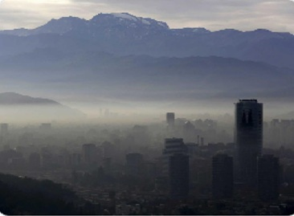
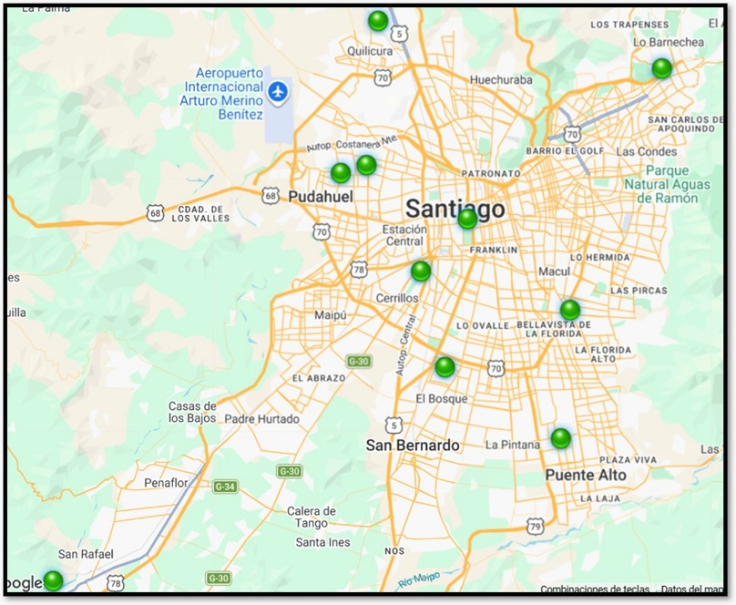
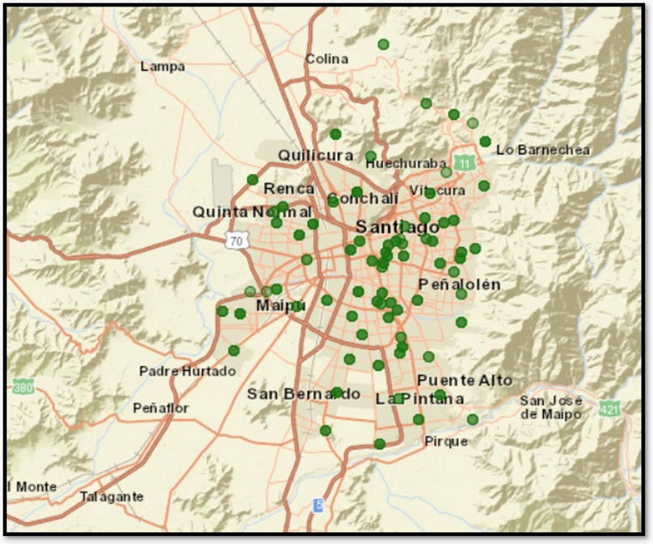
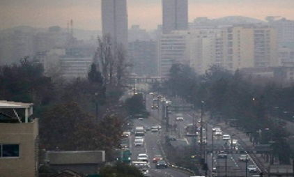
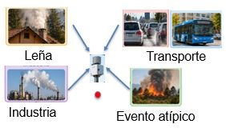
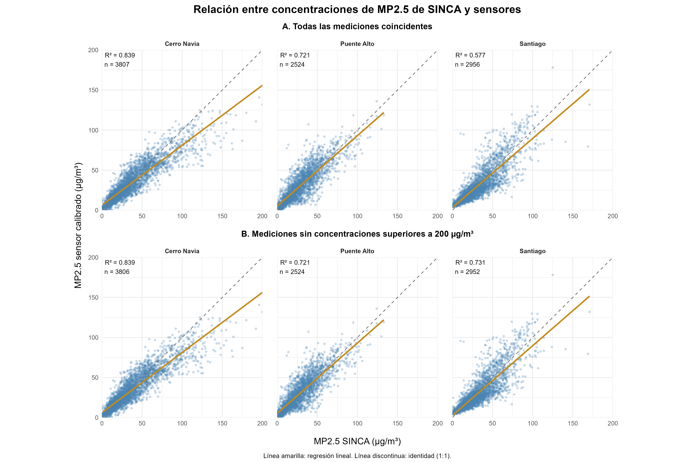
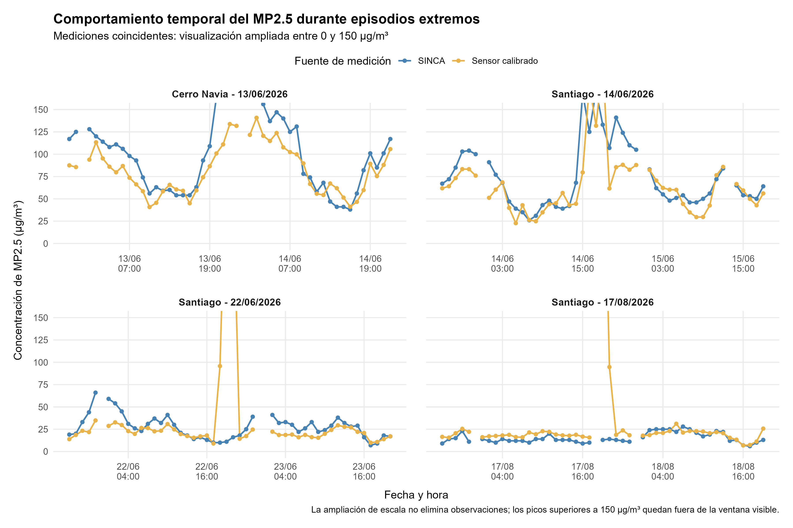

<style>
/* Diseño de la versión HTML; GitHub muestra el contenido sin estilos personalizados. */
html { scroll-behavior: smooth; }
body { font-family: "Segoe UI", Arial, sans-serif; font-size: 16px; line-height: 1.7; color: #171717; background: #f6f8fb; }
.main-container { max-width: 1080px !important; margin: 28px auto !important; padding: 40px 56px 64px !important; background: #ffffff; border: 1px solid #e2e8f0; border-radius: 14px; box-shadow: 0 4px 24px rgba(29,49,75,.06); }
.portada { max-width: 900px; margin: 0 auto 28px; padding: 36px 34px; border: 1.5px solid #b8cbdc; border-radius: 16px; background: #f8fbff; text-align: center; }
.portada h1 { font-size: 35px; line-height: 1.22; color: #171717; margin: 0 0 18px; font-weight: 750; }
.portada .subtitulo { font-size: 21px; font-weight: 600; color: #171717; margin: 0 0 12px; }
.portada .institucion { font-size: 17px; color: #171717; margin: 0 0 12px; }
.portada .autora { font-size: 18px; font-weight: 650; color: #171717; margin: 0 0 22px; }
.portada img { display: block; max-width: 100%; width: 76%; height: auto; margin: auto; border-radius: 10px; border: 1px solid #d5dfe9; }
.navegacion { display: flex; justify-content: center; flex-wrap: wrap; gap: 10px; padding: 14px 12px 24px; margin: 0 auto 25px; max-width: 950px; border-bottom: 1px solid #e2e8f0; }
.navegacion a { display: inline-block; text-decoration: none !important; background: #eaf2fa; color: #174c75 !important; font-weight: 600; font-size: 15px; padding: 10px 16px; border: 1px solid #bcd1e4; border-radius: 8px; }
.navegacion a:hover { background: #d5e8f8; }
h2 { margin-top: 38px; color: #171717; border-bottom: 2px solid #d8e7f3; padding-bottom: 8px; }
h3 { font-weight: 700; color: #171717; margin-top: 26px; }
p, li, td { color: #171717; font-weight: 400; }
table { margin-top: 12px; margin-bottom: 22px; }
pre { overflow-x: auto; }
@media(max-width: 720px) { .main-container { margin: 0 !important; padding: 18px !important; } .portada { padding: 20px 14px; } .portada h1 { font-size: 27px; } .portada .subtitulo { font-size: 18px; } .portada img { width: 100%; } }
</style>

<div class="portada" align="center">

# Análisis exploratorio del MP2.5 en Santiago de Chile

<p class="subtitulo"><strong>Comparación de estaciones SINCA y sensores de bajo costo calibrados</strong></p>
<p class="institucion">Pontificia Universidad Católica de Chile · Doctorado en Ciencias de la Ingeniería · 2026</p>
<p class="autora">María Cristina Olivera Ferrer</p>



</div>

<nav class="navegacion" aria-label="Índice del documento">
<a href="#proyecto">Proyecto</a>
<a href="#datos-y-área-de-estudio">Datos</a>
<a href="#diccionario-de-datos">Diccionario</a>
<a href="#metodología">Metodología</a>
<a href="#resultados-principales">Resultados</a>
<a href="#organización-del-repositorio">Repositorio</a>
<a href="#reproducibilidad">Reproducibilidad</a>
<a href="#referencias">Referencias</a>
</nav>

## Proyecto

El material particulado fino (MP2.5) constituye un problema relevante de calidad del aire en Santiago de Chile. Este proyecto explora su variabilidad espacial y temporal mediante registros horarios de estaciones oficiales SINCA y sensores de bajo costo previamente calibrados, comparados en períodos coincidentes.

Objetivo: analizar las concentraciones de MP2.5 en Cerro Navia, Santiago y Puente Alto, caracterizar sus distribuciones, explorar la asociación lineal entre fuentes y examinar el efecto de observaciones extremas. La calibración instrumental de los sensores no forma parte del estudio.

## Datos y área de estudio

| Comuna | Sector | Estación SINCA | Sensor calibrado |
|:--|:--|:--|:--|
| Cerro Navia | Poniente | Cerro Navia | CH4 |
| Santiago | Centro | Parque O'Higgins | CH56 |
| Puente Alto | Suroriente | Puente Alto | CH2 |

### Justificación de la selección de las comunas

Se seleccionaron las comunas de Cerro Navia, Santiago y Puente Alto debido a su ubicación geográfica en distintos sectores de la ciudad: poniente, centro y suroriente, respectivamente. Esta distribución permite explorar la variabilidad espacial de las concentraciones de MP2.5 en Santiago de Chile. Asimismo, la disponibilidad de mediciones de estaciones SINCA y sensores de bajo costo calibrados en las tres comunas permite comparar las concentraciones horarias coincidentes entre ambas fuentes de información.

| Fuente | Período disponible |
|:--|:--|
| SINCA (tres estaciones) | 01/03/2026–30/09/2026 |
| Sensor CH4 | 19/03/2026–12/09/2026 |
| Sensor CH56 | 16/04/2026–27/08/2026 |
| Sensor CH2 | 05/05/2026–31/08/2026 |

<div align="center">
<table><tr><th>Estaciones SINCA</th><th>Sensores de bajo costo</th></tr><tr><td></td><td></td></tr></table>
</div>

<div align="center">
<table>
<tr><th>Contexto urbano de Santiago</th><th>Fuentes y monitoreo de MP2.5</th></tr>
<tr><td align="center"></td><td align="center"></td></tr>
</table>
</div>

Procedencia: [SINCA, Ministerio del Medio Ambiente](https://sinca.mma.gob.cl/) y registros calibrados facilitados para el proyecto ([Aire Ciudadano](https://sensor.aireciudadano.com/d/xTdfdbchs/sensores-chs?orgId=1)). Los datos originales se conservan sin modificaciones. Las comparaciones utilizan únicamente fechas y horas coincidentes.

## Diccionario de datos

Se construyó un único diccionario manual mediante `tribble()` en `02_scripts/04_validar_datos.r`, con variables comunes a ambas fuentes:

| Variable | Descripción | Tipo | Unidad | Valores esperados / tratamiento de faltantes |
|:--|:--|:--|:--|:--|
| `fuente` | Origen de la medición | Categórica | — | SINCA o sensor de bajo costo; sin NA |
| `comuna` | Sector de monitoreo | Categórica | — | Santiago, Cerro Navia o Puente Alto; sin NA |
| `mp25` | Concentración horaria de MP2.5 | Numérica | µg/m³ | No negativa; 2–200 como intervalo exploratorio de revisión; NA identificados en validación y excluidos en depuración |
| `fecha_hora` | Fecha y hora de medición | Fecha-hora | — | Períodos de 2026 estudiados; sin NA en datos depurados |

Para SINCA, `mp25` se obtiene mediante `coalesce()` con prioridad para registros validados, luego preliminares y finalmente no validados. Las concentraciones inferiores a 2 o superiores a 200 µg/m³ se revisan, pero no se eliminan automáticamente. El intervalo es un criterio exploratorio, no un límite normativo.

## Metodología

| Etapa | Procedimiento |
|:--|:--|
| 1. Importación y exploración | Cargar seis archivos originales y revisar estructura, períodos y valores faltantes |
| 2. Validación | Homogeneizar variables; documentar datos; identificar duplicados, NA y alertas |
| 3. Depuración | Excluir concentraciones faltantes o negativas y registros sin fecha-hora válida |
| 4. Integración | Emparejar mediciones horarias coincidentes por comuna |
| 5. Distribución | Calcular estadísticas descriptivas y visualizar boxplots |
| 6. Relación lineal | Ajustar regresiones por comuna y examinar R² |
| 7. Sensibilidad | Comparar modelos con todos los pares y sin pares con alguna concentración > 200 µg/m³ |
| 8. Episodios extremos | Examinar ventanas de 24 h antes y después de los episodios |

El procesamiento y análisis de los datos se realizó en R, utilizando principalmente los paquetes `tidyverse` y `ggplot2`. Mediante modelos de regresión lineal se evaluó la relación entre las concentraciones horarias de MP2.5 registradas por las estaciones SINCA y los sensores de bajo costo calibrados. Los valores del coeficiente de determinación (R²) muestran distintos grados de asociación lineal entre ambas fuentes según la comuna, al indicar la proporción de variabilidad explicada por cada modelo. Este resultado describe la relación estadística entre las mediciones, sin demostrar por sí solo concordancia instrumental.

## Resultados principales

### 1. Mediciones coincidentes

Se integraron 9.287 pares horarios:

| Comuna | Pares coincidentes |
|:--|--:|
| Cerro Navia | 3.807 |
| Puente Alto | 2.524 |
| Santiago | 2.956 |
| Total | 9.287 |

### 2. Distribución de MP2.5

| Comuna | Promedio SINCA (µg/m³) | Promedio sensor (µg/m³) |
|:--|--:|--:|
| Cerro Navia | 34,1 | 31,7 |
| Puente Alto | 30,0 | 31,6 |
| Santiago | 31,8 | 30,8 |

<div align="center">


*Figura 1. Distribución de las concentraciones horarias coincidentes, con escala ampliada.*
</div>

Cerro Navia presenta el promedio SINCA más alto de las tres comunas en los períodos coincidentes. Las diferencias de cobertura temporal impiden interpretar estos promedios como comparaciones estacionales equivalentes.

### 3. Regresión y sensibilidad a valores extremos

| Comuna | R² con todos los pares | R² sin extremos | Pares excluidos |
|:--|--:|--:|--:|
| Cerro Navia | 0,839 | 0,839 | 1 |
| Puente Alto | 0,721 | 0,721 | 0 |
| Santiago | 0,577 | 0,731 | 4 |

<div align="center">


*Figura 2. Sensibilidad del ajuste lineal a las observaciones superiores a 200 µg/m³.*
</div>

En Santiago, retirar cuatro pares extremos eleva R² de 0,577 a 0,731. La exclusión se utiliza solo en el análisis de sensibilidad, sin modificar la base general.

### 4. Episodios extremos

Se identificaron cinco pares extremos, agrupados en cuatro episodios:

| Comuna | Fecha | Pares extremos | Fuente que supera 200 µg/m³ |
|:--|:--|--:|:--|
| Cerro Navia | 13/06/2026 | 1 | SINCA |
| Santiago | 14/06/2026 | 1 | CH56 |
| Santiago | 22/06/2026 | 2 | CH56 |
| Santiago | 17/08/2026 | 1 | CH56 |

<div align="center">


*Figura 3. Episodios extremos con escala ampliada de 0 a 150 µg/m³.*
</div>

Los episodios del 22 de junio y 17 de agosto en Santiago presentan picos abruptos en CH56 sin incrementos equivalentes en Parque O'Higgins. Los registros disponibles no permiten determinar de forma concluyente el origen de esos picos.

## Conclusiones

Las mediciones de SINCA y sensores calibrados muestran asociaciones lineales positivas, con diferencias entre comunas. Un número reducido de pares extremos modifica apreciablemente el ajuste en Santiago. Estos valores podrían relacionarse con un evento atípico, como un incendio, aunque no se ha determinado su origen. Por ello, conviene examinar su contexto temporal antes de decidir si excluirlos de un análisis.


## Organización del repositorio

La siguiente estructura muestra las carpetas, subcarpetas y archivos del proyecto.

    proyecto-final-mp25/
    |
    |-- 01_datos/
    |   |-- 01_datos_crudos/
    |   |   |-- 01_sinca/
    |   |   |   |-- 01_sinca_cerro_navia_mp25_2026.csv
    |   |   |   |-- 02_sinca_parque_ohiggins_mp25_2026.csv
    |   |   |   |-- 03_sinca_puente_alto_mp25_2026.csv
    |   |   |-- 02_sensores_bajo_costo/
    |   |   |   |-- 01_sensor_cerro_navia_ch4_mp25_2026.csv
    |   |   |   |-- 02_sensor_parque_ohiggins_ch56_mp25_2026.csv
    |   |   |   |-- 03_sensor_puente_alto_ch2_mp25_2026.csv
    |   |-- 02_datos_procesados/
    |   |   |-- 01_sinca/
    |   |   |   |-- 01_sinca_cerro_navia_mp25_2026.csv
    |   |   |   |-- 02_sinca_parque_ohiggins_mp25_2026.csv
    |   |   |   |-- 03_sinca_puente_alto_mp25_2026.csv
    |   |   |-- 02_sensores_bajo_costo/
    |   |   |   |-- 01_sensor_cerro_navia_ch4_mp25_2026.csv
    |   |   |   |-- 02_sensor_parque_ohiggins_ch56_mp25_2026.csv
    |   |   |   |-- 03_sensor_puente_alto_ch2_mp25_2026.csv
    |   |   |-- 03_comparacion_sinca_sensores/
    |   |   |   |-- 01_comparacion_cerro_navia.csv
    |   |   |   |-- 02_comparacion_parque_ohiggins.csv
    |   |   |   |-- 03_comparacion_puente_alto.csv
    |   |   |   |-- 04_mediciones_horarias_coincidentes_sinca_sensores_tres_comunas.csv
    |
    |-- 02_scripts/
    |   |-- 01_cargar_librerias.r
    |   |-- 02_cargar_datos.r
    |   |-- 03_explorar_datos.r
    |   |-- 04_validar_datos.r
    |   |-- 05_depurar_datos.r
    |   |-- 06_integrar_mediciones_sinca_sensores.r
    |   |-- 07_boxplots_sinca_sensores.r
    |   |-- 08_regresion_lineal_r2_sinca_sensores.r
    |   |-- 09_analizar_episodios_extremos.r
    |
    |-- 03_figuras/
    |   |-- 01_comparacion_sinca_sensores/
    |   |   |-- 01_boxplots/
    |   |   |   |-- 01_boxplot_sinca_sensores_por_comuna.png
    |   |   |   |-- 02_boxplot_sinca_sensores_por_comuna_ampliado.png
    |   |   |-- 02_modelos_lineales/
    |   |   |   |-- 01_regresion_lineal_r2_sinca_sensores_por_comuna.png
    |   |   |-- 03_analisis_sensibilidad/
    |   |   |   |-- 02_comparacion_regresiones_r2_sinca_sensores.png
    |   |   |-- 04_episodios_extremos/
    |   |   |   |-- 01_series_temporales_episodios_extremos.png
    |   |   |   |-- 02_series_temporales_episodios_extremos_ampliado.png
    |
    |-- 04_tablas/
    |   |-- 01_exploracion/
    |   |   |-- 01_estadisticas_iniciales_sinca_sensores.csv
    |   |-- 02_validacion/
    |   |   |-- 01_diccionario_datos_sinca_sensores.csv
    |   |   |-- 02_revision_duplicados_sinca_sensores.csv
    |   |   |-- 03_resumen_alertas_sinca_sensores.csv
    |   |   |-- 04_concentraciones_superiores_200_sinca_sensores.csv
    |   |   |-- 05_registros_con_alertas_sinca_sensores.csv
    |   |-- 03_depuracion/
    |   |   |-- 01_resumen_datos_procesados_sinca_sensores.csv
    |   |-- 04_integracion/
    |   |   |-- 01_mediciones_coincidentes_sinca_sensores.csv
    |   |-- 05_boxplots/
    |   |   |-- 01_estadisticas_descriptivas_sinca_sensores_por_comuna.csv
    |   |-- 06_regresion_lineal/
    |   |   |-- 01_modelos_lineales_r2_sinca_sensores.csv
    |   |   |-- 02_pares_extremos_sinca_sensores.csv
    |   |   |-- 03_sensibilidad_r2_sinca_sensores.csv
    |
    |-- 05_imagenes/
    |   |-- 01_santiago1.jpg
    |   |-- 02_santiago2.jpg
    |   |-- 03_fsensor.jpg
    |   |-- 04_sinca.jpg
    |   |-- 05_sensores.jpg
    |
    |-- 06_informe/
    |   |-- informe_final_mp25_santiago.qmd
    |
    |-- renv/
    |-- renv.lock
    |-- .gitignore
    |-- .Rprofile
    |-- readme.md
    |-- readme.html
    |-- proyecto-final-mp25.Rproj

## Reproducibilidad

El repositorio conserva los datos originales y usa rutas relativas. El ambiente de paquetes se registra en `renv.lock`. Para reproducir el procesamiento:

```r
renv::restore()
renv::status()
```


## Referencias

- [Sistema de Información Nacional de Calidad del Aire (SINCA)](https://sinca.mma.gob.cl/). Ministerio del Medio Ambiente de Chile.
- [Aire Ciudadano: sensores CHS](https://sensor.aireciudadano.com/d/xTdfdbchs/sensores-chs?orgId=1).
- Jorquera, H., & Barraza, F. (2012). Source apportionment of ambient PM2.5 in Santiago, Chile: 1999 and 2004 results. *Science of the Total Environment, 435–436*, 418–429. https://doi.org/10.1016/j.scitotenv.2012.07.049
- Romero, H., et al. (2010). Climas urbanos y contaminación atmosférica en Santiago de Chile. *EURE, 36*(109). [Artículo](https://www.scielo.cl/scielo.php?pid=S0250-71612010000300002&script=sci_arttext).
- Wilke, C. O. (2019). *Fundamentals of Data Visualization*. O'Reilly Media. https://clauswilke.com/dataviz/
